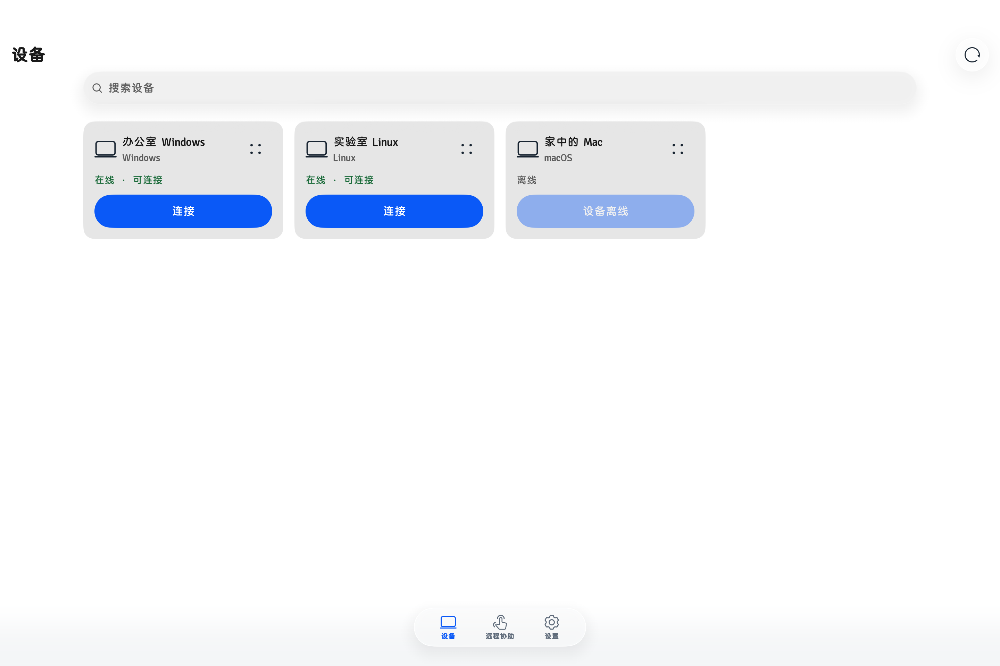
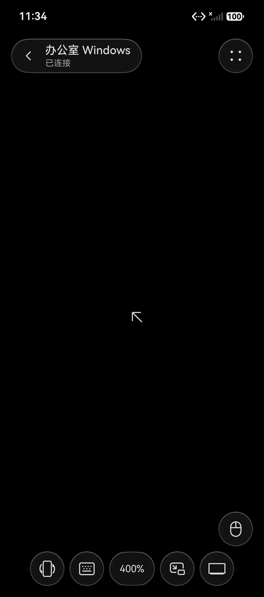
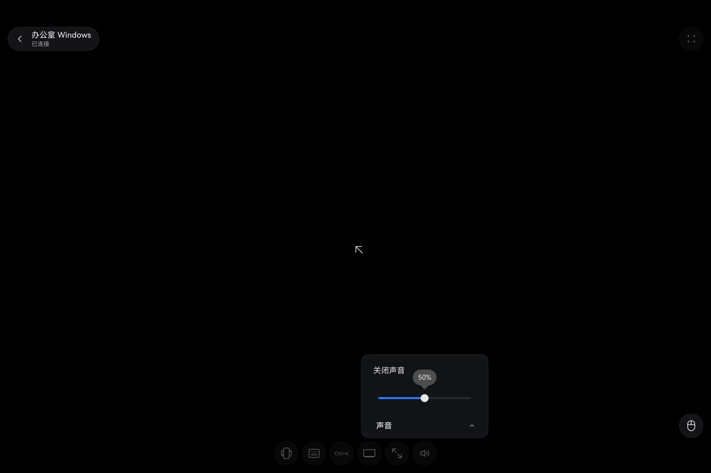

# UU Remote for HarmonyOS

基于 [VallierDev/uu-remote-linux](https://github.com/VallierDev/uu-remote-linux) 的 HarmonyOS 移植分支（fork）。原项目提供 Linux 被控端和实验性主控端。本分支复用其 Rust 核心，新增 ArkTS/ArkUI 主控界面及 HarmonyOS 媒体和输入适配。由社区独立维护，与网易 UU 远程及华为官方无隶属关系。

## 截图

| Pad 设备列表 | 手机远控与倍率工具栏 | Pad 音量快捷菜单 |
| --- | --- | --- |
|  |  |  |

截图使用测试设备和模拟会话。

## 功能

- 设备列表、远程协助和远程桌面，支持触控板、直接触控、虚拟鼠标、电脑键盘和自定义组合键。
- 可自定义远控工具栏，调整音量、切换输入、查看网络状态和缩放远端画面。
- 在「设置 → 通用设置 → 远程操控」中可切换「后台远程控制」。若系统挂起导致断线，返回应用时会尝试重连同一台设备。系统播控中心显示当前被控设备的名称和远控画面状态。Pad 实测，远端声音播放时退到桌面，系统状态栏显示可展开的实况胶囊，展开后可查看完整设备名。静音时系统未显示胶囊。
- 文件传输、终端和端口映射取决于远端设备与会话权限。系统材质和画中画取决于设备能力。

## 下载与构建

- [未签名 HAP（v1.0.0）](downloads/uu-remote-harmony-1.0.0-unsigned.hap) · [SHA-256](downloads/SHA256SUMS.txt)
- 未签名包需用自己的 HarmonyOS 签名配置签名后安装。
- [HarmonyOS 构建和签名](harmony/README.md) · [上游 Linux 文档](README.linux.md) · [Upstream Linux documentation (English)](README.en.md)

## 版权与许可

上游代码版权归 `uu-remote-linux` 原作者及各贡献者所有。HarmonyOS 移植改动版权归 avengerdsf 及各移植贡献者所有。项目代码按 [GPL-3.0-or-later](LICENSE) 发布。上游提交记录与原有许可声明随仓库保留。

第三方组件、图标来源和商标说明见 [NOTICE](NOTICE.md)。
